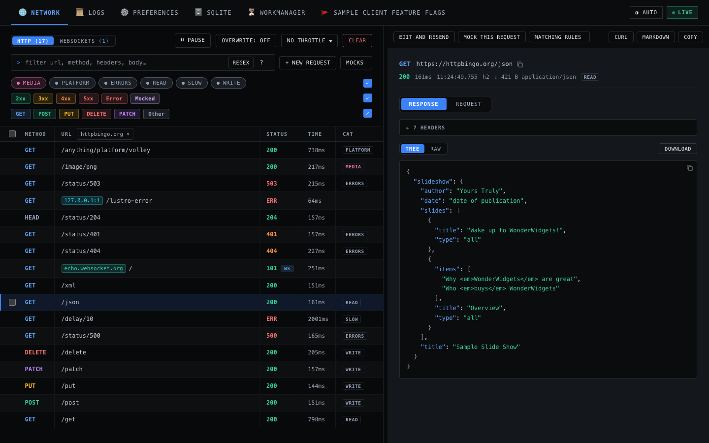

<h1 align="center">
  <picture>
    <source media="(prefers-color-scheme: dark)" srcset="art/lustro-wordmark-dark.png">
    
  </picture>
</h1>

<p align="center"><b>Debug your Android app in a desktop browser: network inspector, logs,
databases, and preferences, with a JSON API for AI agents.</b></p>

<p align="center">
  <a href="LICENSE"></a>
  <a href="https://github.com/Twinsen81/Lustro/actions/workflows/ci.yml"></a>
  <a href="https://central.sonatype.com/repository/maven-snapshots/io/github/twinsen81/lustro/"></a>
  <a href="https://twinsen81.github.io/Lustro/"></a>
</p>

Lustro is an open-source debugging library for the debug builds of Android apps. It runs a small
web server inside your app and shows the app's network traffic, logs, SharedPreferences, SQLite
and Room databases, and WorkManager jobs as tabs in a desktop browser. Every tab is also a JSON API
with an OpenAPI document, so AI coding agents, scripts, and the `lustro` CLI can read the same data
without a browser.



> **Status:** early development (pre-1.0). There is no stable release yet. Only `0.1.0-SNAPSHOT`
> builds exist, in the Sonatype Central snapshots repository. The Kotlin API and the wire protocol
> can change from one snapshot to the next.

**[Read the Lustro documentation](https://twinsen81.github.io/Lustro/)**

## Features

| Tab | What it does |
| --- | --- |
| [Network](https://twinsen81.github.io/Lustro/network/okhttp/) | Captures OkHttp traffic and WebSocket messages. Mocks responses, delays requests with a throttle, sends requests through the app's own clients, and exports HAR and Markdown. |
| [Logs](https://twinsen81.github.io/Lustro/plugins/logs/) | The app's own logcat, filtered by level, tag, text, and time. |
| [Preferences](https://twinsen81.github.io/Lustro/plugins/prefs/) | Reads and edits SharedPreferences and Preferences DataStores. |
| [SQLite](https://twinsen81.github.io/Lustro/plugins/sqlite/) | Browses SQLite and Room databases and runs SQL queries. |
| [WorkManager](https://twinsen81.github.io/Lustro/plugins/work/) | Shows WorkManager work and the events of each run. Cancels and prunes work. |
| [Screen](https://twinsen81.github.io/Lustro/plugins/screen/) | For agents and scripts: the app's windows and UI tree, with Views and Compose semantics nodes. |
| [Your own tabs](https://twinsen81.github.io/Lustro/custom-tabs/) | A `DebugTab` subclass with JSON routes and, if you want, a view in the browser. |

The Network tab is in the main artifact. Each other tab is a plugin with its own artifact.

## Why Lustro

- **A full screen.** You inspect the app in a desktop browser, not in a small on-device overlay.
  You do not install a desktop app: a browser and `adb` are enough.
- **Made for automation.** Each tab has JSON routes and an OpenAPI document. The `lustro` CLI and
  an agent skill let Claude Code, Codex, Cursor, and other coding agents debug the running app.
- **Not in release builds.** Each artifact has a no-op half for release builds. The runtime does
  not start in a build that is not debuggable, unless you opt in, and a lint check fails the
  release build if your own debug tabs are in the wrong source set.
- **Private by default.** The server listens on `127.0.0.1` only, while the app is in the
  foreground, and every API request needs a 256-bit token. Captured traffic and logs stay in memory.
- **Extensible.** Add your own tabs through the same plugin contract that Lustro's own tabs use.

## Quick start: add Lustro to an Android app

1. Add the snapshots repository to `settings.gradle.kts`:

    ```kotlin
    dependencyResolutionManagement {
        repositories {
            mavenCentral()
            maven("https://central.sonatype.com/repository/maven-snapshots/")
        }
    }
    ```

2. Add the runtime for debug builds and the no-op half for release builds, in
   the app module's `build.gradle.kts`:

    ```kotlin
    dependencies {
        debugImplementation("io.github.twinsen81:lustro:0.1.0-SNAPSHOT")
        releaseImplementation("io.github.twinsen81:lustro-noop:0.1.0-SNAPSHOT")
    }
    ```

3. Build Lustro once, in `Application.onCreate()`, add its interceptor to your
   OkHttp client, and start it on the main thread:

    ```kotlin
    val lustro = Lustro.builder(application)
        .addTab(NetworkDebugTab.create())
        .build()

    val httpClient = OkHttpClient.Builder()
        .addInterceptor(lustro.networkInterceptor())
        .build()

    lustro.start()
    ```

4. Run the debug build, keep the app in the foreground, and open the console.
   The [`lustro` CLI](https://twinsen81.github.io/Lustro/get-started/install/#the-lustro-cli) forwards the
   port and opens the browser with the token:

    ```bash
    lustro open
    ```

    Without the CLI, forward the port with `adb forward tcp:8080 tcp:8080`,
    read the token with `adb logcat -d -s LustroToken`, and open
    `http://localhost:8080/#lustro_token=<token>`.

Lustro needs `minSdk` 24, `compileSdk` 35, Android Gradle Plugin 8.6, and Kotlin 2.0. It does not
raise the versions of your app's own dependencies: see
[Minimum versions](https://twinsen81.github.io/Lustro/get-started/install/#minimum-versions).
To add the Logs, Preferences, SQLite, WorkManager, and Screen tabs, see
[Modules](https://twinsen81.github.io/Lustro/reference/modules/).

## Use Lustro with AI coding agents

Give a coding agent the repository, for example "Add Lustro to this app, following
https://github.com/Twinsen81/Lustro, and check the integration". [`llms.txt`](llms.txt) summarizes
Lustro for agents and links the rest of the docs. The [`lustro` skill](skills/lustro/SKILL.md)
teaches an agent to debug the app through the `lustro` CLI, and to add Lustro and check the
integration. It works with Claude Code, Codex, Cursor, GitHub Copilot, and Gemini CLI. Install it
into your project:

```bash
npx skills add Twinsen81/Lustro --skill lustro
```

See [With a coding agent](https://twinsen81.github.io/Lustro/get-started/coding-agent/) for the other ways to install it.

## How Lustro compares

| Tool | Where you inspect the app | Notes |
| --- | --- | --- |
| **Lustro** | A desktop browser, through `adb forward` | Network, logs, preferences, databases, WorkManager. JSON API and OpenAPI for each tab, `lustro` CLI, agent skill. |
| [Chucker](https://github.com/ChuckerTeam/chucker) | On the device | HTTP inspector for OkHttp. |
| [Pluto](https://github.com/androidPluto/pluto) | On the device | Network, crashes and ANRs, app data. |
| [Flocon](https://github.com/openflocon/Flocon) | A desktop app | Inspired by Flipper. Network, databases, preferences, and more, for Android, Kotlin Multiplatform, iOS, and Flutter. MCP server for AI agents. |
| [Flipper](https://github.com/meta/flipper) | A desktop app | From Meta. The repository is archived. |
| [Stetho](https://github.com/meta/stetho) | Chrome DevTools | From Meta. The repository is archived. |
| Android Studio Network Inspector | Android Studio | Built into the IDE. No library to add. |

## FAQ

### Does Lustro add code to my release build?

No server and no capture code. A release build gets only the `-noop` artifacts, which have the
same API with empty method bodies, and the small `lustro-api` module, so the same code compiles for
both build types. By default, the Lustro runtime also refuses to start in a build that is not
debuggable. See
[Release safety](https://twinsen81.github.io/Lustro/concepts/release-safety/).

### Is the Lustro server open to my network?

No. By default the Lustro server binds to `127.0.0.1` on the device, and you reach it from your
computer with `adb forward`. Every API request needs a token. You can bind all interfaces for LAN
access, but you must opt in. See [Security model](https://twinsen81.github.io/Lustro/concepts/security/).

### Which HTTP clients does Lustro capture?

OkHttp, and every library that sends requests through an OkHttp client with the Lustro interceptor,
such as Retrofit. Platform `HttpURLConnection` capture is opt-in. For any other client, an adapter
reports each request to `networkCaptureSink()`. See
[Other HTTP clients](https://twinsen81.github.io/Lustro/network/other-clients/).

### Can I mock API responses with Lustro?

Yes. The Network tab has mock rules that match requests and return the response that you define,
and a throttle that delays each request. See [Mock rules](https://twinsen81.github.io/Lustro/network/mocks/).

### Do I need Android Studio or a desktop app?

No. You need a desktop browser and `adb`. The `lustro` CLI is optional: it forwards the port and
opens the browser for you.

### Is Lustro a replacement for Chucker or Flipper?

For many debug tasks, yes: Lustro inspects network traffic like Chucker, and shows logs,
preferences, and databases like Flipper did. The differences: the Lustro UI is in a desktop browser,
and each tab is also a JSON API for scripts and AI agents. Lustro does not show its data on the
device itself, and it does not keep crash reports: a crash that ends the app's process ends the
server too. See [How Lustro compares](#how-lustro-compares).

## Documentation

| Section | What it has |
| --- | --- |
| [Get started](https://twinsen81.github.io/Lustro/get-started/install/) | Install, the minimum versions, the `lustro` CLI, the quick start, the console, and a check of the integration. |
| [Network tab](https://twinsen81.github.io/Lustro/network/okhttp/) | OkHttp capture, the console controls, WebSocket messages, Send Request, export, mock rules, redaction and categories, `HttpURLConnection`, and other HTTP clients. |
| [Plugins](https://twinsen81.github.io/Lustro/plugins/logs/) | The Logs, Preferences, SQLite, WorkManager, and Screen tabs. |
| [Custom tabs](https://twinsen81.github.io/Lustro/custom-tabs/) | Your own `DebugTab`, a tutorial that writes one, and the styleguide for its view. |
| [Agents and automation](https://twinsen81.github.io/Lustro/AGENTS/) | The `lustro` CLI, token discovery, the HTTP routes of each tab, and the wire protocol. |
| [Concepts](https://twinsen81.github.io/Lustro/concepts/how-it-works/) | How Lustro works, release safety, the security model, and LAN exposure. |
| [Reference](https://twinsen81.github.io/Lustro/reference/troubleshooting/) | Troubleshooting, the modules, the configuration, the glossary, and the [Kotlin API reference](https://twinsen81.github.io/Lustro/api/). |

The pages are Markdown files in [`docs/`](docs/), so an agent can also read them in the
repository.

See also: [CONTRIBUTING.md](CONTRIBUTING.md) · [SECURITY.md](SECURITY.md) ·
[CHANGELOG.md](CHANGELOG.md) · [DECISIONS.md](DECISIONS.md)

## License

Lustro is licensed under the [Apache License 2.0](LICENSE).
