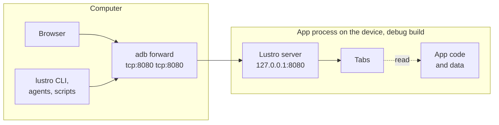
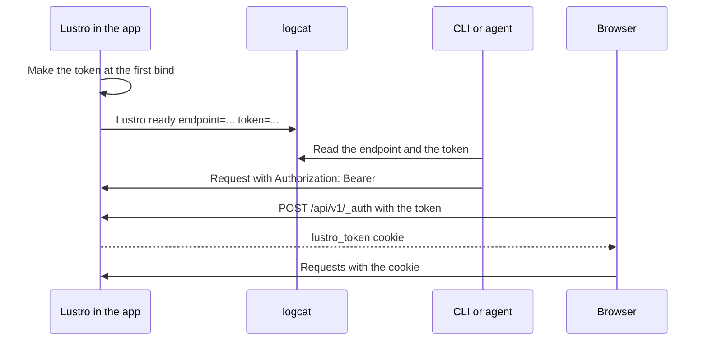
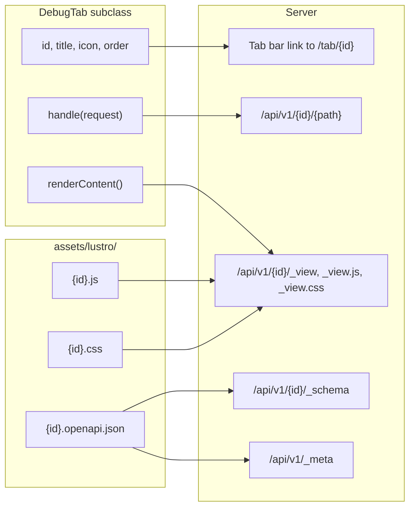

# How Lustro works

Lustro is a small HTTP server inside the process of an app's debug build. The browser console, the
`lustro` CLI, and agents on the computer reach it through an adb port forward. Each tab of the
console is a Kotlin class in the app and a set of JSON routes under `/api/v1/<id>/`. This page
explains how these parts fit together. The pages that it links give the details.

## The parts

- **The server** runs in the app's process, so a tab reads the app's objects directly: its OkHttp
    traffic, its databases, its preferences, its windows. There is no agent process on the device
    and no instrumentation.
- **The address** is `127.0.0.1:8080` by default. Only the device itself can connect to a loopback
    address, so the computer connects through `adb forward`. `lustro open` makes the forward for
    you. See [Accessing the UI](../get-started/console.md), and
    [LAN exposure and port forwarding](lan.md) for the opt-in to other addresses.
- **The token** is in the `LustroToken` line of logcat, and every client needs it: see
    [the flow of the token](#the-flow-of-the-token).
- **The clients** are the browser console and anything that sends HTTP: the
    [`lustro` CLI](../get-started/install.md#the-lustro-cli), `curl`, and coding agents. They use
    the same routes. The console is one more client of the JSON API.

## When the server listens

`Lustro.start()` does not open the socket itself. It adds an observer to the process lifecycle,
and the server listens only while the app is in the foreground:

- When the app comes to the foreground, the server binds its port and logs the `LustroToken`
  line again.
- When the app goes to the background, the server stops taking new requests, waits up to 5 s for
  the requests in progress, and closes the socket.
- `Lustro.stop()` removes the observer and closes the socket at once.

While the app is in the background, a request through the forward gets no response: adb closes
the connection. When the port is taken, the server tries again for 10 s, or binds another port with `bindFallback`: see
[Troubleshooting](../reference/troubleshooting.md).

## The flow of a request

Every request to `/api/v1/` passes the same checks, in this order. The first check that fails
answers with the [error envelope](../wire-protocol.md):

1. A request with a `Transfer-Encoding` header, such as a chunked body, or with a `Content-Length`
    that is not valid, gets a `400`.
2. A body larger than [`maxRequestBodyBytes`](../reference/configuration.md) gets a `413`, before
    the server reads it.
3. A request without a valid token gets a `401`.
4. A browser request from another origin gets a `403`: see [Security model](security.md).
5. The server reads the body. All the bodies in memory at one time stay under
    `maxConcurrentRequests` × `maxRequestBodyBytes`, so a request can wait for room first.
6. The request waits for one of the [`maxConcurrentRequests`](../reference/configuration.md)
    slots. When the slots and the queue are full, or when a wait for room or for a slot is longer
    than `requestTimeoutMs`, it gets a `503`.
7. The server routes the request. It answers the framework routes `_meta` and `_schema` itself.
    For `/api/v1/<id>/<path>`, it finds the tab with that id and calls its `handle(request)`.
8. When `handle` returns `null`, the client gets a `404`. When it throws anything, the client gets
    a `500`, and the app does not crash. When it runs longer than
    [`requestTimeoutMs`](../reference/configuration.md), the client gets a `504`, and the server
    cancels the request.

`POST /api/v1/_auth` is the only route that needs no token, and it has its own checks: another
method gets a `405`, a request from another origin a `403`, a body larger than a small limit a
`413`, and a wrong token a `401`.

Every response, the error responses too, has the Content Security Policy and
`X-Content-Type-Options: nosniff`.

## The flow of the token

Every API request needs the token. The app makes it once, and the clients read it on the
computer:

1. On the first bind, the server makes a random 256-bit token and saves it in the app's private
    `lustro_debug` SharedPreferences file, with the host and the port. The token stays the same
    until the app's data is cleared or the app is installed again.
2. After each bind, the server logs one line at the `LustroToken` tag:
    `Lustro ready endpoint=http://127.0.0.1:8080 token=<token>`.
3. The CLI and agents read the line, or the prefs file through `adb shell run-as` when the device
    drops Info logs. They send the token in the `Authorization: Bearer <token>` header of each
    request.
4. The browser gets the token in the URL fragment `#lustro_token=<token>`. The console's script
    sends it to `POST /api/v1/_auth`, which sets the `lustro_token` cookie, `HttpOnly` and
    `SameSite=Strict`. The script then removes the fragment from the address bar.

The server removes the `Authorization` and `Cookie` headers before it calls a tab, so a tab never
sees the token. The details of token discovery are in
[Driving Lustro from agents](../AGENTS.md#auth-and-token-discovery).

## The anatomy of a tab

A tab is a `DebugTab` subclass. The built-in Network tab, the plugins, and your own tabs use the
same class. The server builds the console's tab bar and the tab's routes from it:

- **The tab bar** lists the tabs by `order`, lower first, and then by id. The Network tab is
    `10`, the plugins are `20` to `60`, and the default is `100`. A tab with
    `showInTabBar = false` has no link, but its routes work.
- **The page** `/tab/<id>` needs no token, and it has only the tab bar and an empty content area.
    After the browser has the cookie, `shared.js` loads the tab's HTML from `_view`, then its CSS
    and JS from `_view.css` and `_view.js`. The tab's own content is never served before the token
    is checked.
- **The routes** under `/api/v1/<id>/` go to `handle(request)`, with `request.path` set to the
    part after the id.
- **The OpenAPI document** is served at `/api/v1/<id>/_schema`. Only a tab with a document is in
    `GET /api/v1/_meta`, so agents find only those tabs. The `version` in `_meta` is the
    document's `info.version`.
- **The assets** are the files `assets/lustro/<id>.js`, `<id>.css`, and `<id>.openapi.json`.
    `renderScript()`, `renderStyles()`, and `schema()` can return them from code instead.

[Write a tab](../write-a-tab.md) builds a tab step by step, and [Custom tabs](../custom-tabs.md)
gives the rules for the code and the assets.

## The threads of a tab

| Code | Thread |
| --- | --- |
| `Lustro.start()` and `Lustro.stop()` | The main thread. `start()` from another thread returns `DISABLED`. |
| `DebugTab.onStart()` and `onStop()` | The thread that calls `Lustro.start()` or `Lustro.stop()`, once each. They do not run when the app goes to the background. |
| `DebugTab.handle(request)`, `renderContent()`, `renderScript()`, `renderStyles()`, `schema()` | A `lustro-request-worker` thread, never the main thread. Calls can run at the same time on different threads. |
| Actions from `request.onCancel { }` | A server thread, when the request times out or the server stops. Such an action can run after `handle` has returned. |
| Reading the request and writing the response | A `lustro-http-<n>` thread, one for each open connection. |
| The bind when the app comes to the foreground | The main thread, in `Lustro.start()` and in the process lifecycle's callback. |
| The retries of a bind to a taken port, the drain and close when the app goes to the background, and the `LustroToken` line | The `lustro-worker` thread. |

Thus a tab with mutable state must make it thread-safe. A tab can block on I/O in `handle`,
because the per-request timeout limits the wait. [Custom tabs](../custom-tabs.md) gives the rules
for cancellation.
