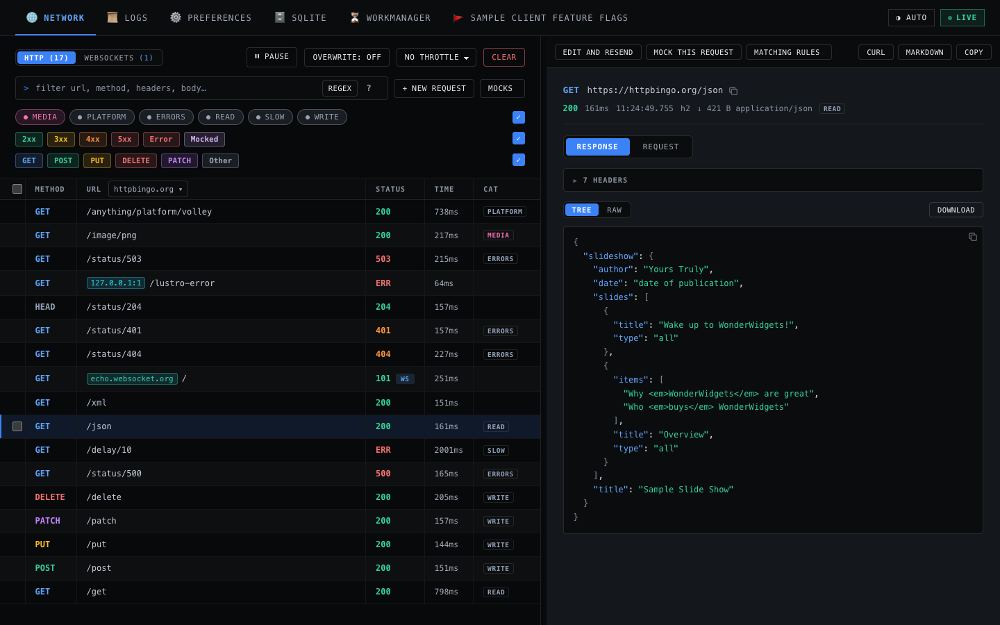

# Lustro { .md-visually-hidden }

{ .lustro-wordmark }
{ .lustro-wordmark }

Lustro is a debugging library for the debug builds of an Android app. It runs a
small web server in the app's process and shows the app's data as tabs in a
desktop browser. Every tab is also a JSON API, so AI agents, scripts, and the
`lustro` command-line tool can use the same data without a browser.

`0.1.0` is the first stable release. Patch releases (`0.1.x`) fix bugs and
do not change the Kotlin API or the HTTP API. If a change ever breaks either
one, it comes in a new minor version, and the
[CHANGELOG](https://github.com/Twinsen81/Lustro/blob/main/CHANGELOG.md) says
so. The API that declares a tab's routes, marked `@ExperimentalDebugRoutes`,
can change in any release.



## What you get

| Tab | What it shows and does |
| --- | --- |
| [**Network**](network/okhttp.md) | Captures OkHttp traffic, the messages of WebSockets, and, when you opt in, `HttpURLConnection` traffic. Mocks responses, throttles requests, sends requests through the app's own clients, and exports HAR files. |
| [**Logs**](plugins/logs.md) | The app's own logcat, with filters for level, tag, text, and time. |
| [**Preferences**](plugins/prefs.md) | Reads and edits the app's SharedPreferences and Preferences DataStores. |
| [**SQLite**](plugins/sqlite.md) | Reads the app's SQLite and Room databases, and runs SQL. Writes only to the databases that the app allows. |
| [**WorkManager**](plugins/work.md) | The app's work, the events of each run, and Cancel and Prune. |
| [**Screen**](plugins/screen.md) | For agents and scripts, through the API only: every window of the app and the UI tree in each, the classic Views and the Compose semantics nodes, read in the app's process in milliseconds. |
| [**Your own tabs**](custom-tabs.md) | A `DebugTab` subclass with JSON routes and, if you want, a view in the browser. |

The Network tab is built in: it is in the main artifact, `lustro`. Logs,
Preferences, SQLite, WorkManager, and Screen are plugins, each with an artifact
of its own.

A release build gets no server. Each artifact has a no-op half with the same
API and empty method bodies: you add the runtime with `debugImplementation`
and the no-op half with `releaseImplementation`, and the same code compiles
for both build types.

## Quick start

1. Add the runtime for debug builds and the no-op half for release builds, in
   the app module's `build.gradle.kts`. The artifacts are on Maven Central:

    ```kotlin
    dependencies {
        debugImplementation("io.github.twinsen81:lustro:0.1.0")
        releaseImplementation("io.github.twinsen81:lustro-noop:0.1.0")
    }
    ```

2. Build Lustro once, in `Application.onCreate()`, add its interceptor to your
   OkHttp client, and start it on the main thread:

    ```kotlin
    val lustro = Lustro.builder(application)
        .addTab(NetworkDebugTab.create())
        .build()

    val httpClient = OkHttpClient.Builder()
        .addInterceptor(lustro.networkInterceptor())
        .build()

    lustro.start()
    ```

3. Run the debug build, keep the app in the foreground, and open the console.
   Forward the port and read the token:

    ```bash
    adb forward tcp:8080 tcp:8080
    adb logcat -d -s LustroToken      # Lustro ready endpoint=... token=<token>
    ```

    Then open `http://localhost:8080/#lustro_token=<token>` in a desktop
    browser. The [`lustro` CLI](get-started/install.md#the-lustro-cli) does
    these steps with one command, `lustro open`.

Lustro needs `minSdk` 24, `compileSdk` 35, Android Gradle Plugin 8.6, and
Kotlin 2.0. It does not raise the versions of your app's own dependencies: see
[Minimum versions](get-started/install.md#minimum-versions).

## Next steps

- [Install](get-started/install.md): the version catalog, the minimum versions,
  and the `lustro` CLI.
- [Check the integration](get-started/check.md): what shows that capture works
  and that the release build has no runtime.
- [Network tab](network/okhttp.md): capture setup, WebSocket messages, Send
  Request, export, mock rules, and other HTTP clients.
- [Plugins](plugins/logs.md): the Logs, Preferences, SQLite, WorkManager, and
  Screen tabs.
- [Custom tabs](custom-tabs.md): your own tab, and the
  [styleguide](STYLEGUIDE.md) for its view.
- [Agents and automation](AGENTS.md): the `lustro` tool, token discovery, and
  the HTTP routes of each tab.
- [How Lustro works](concepts/how-it-works.md): the server, the port forward, the
  token, and the parts of a tab.
- [Security model](concepts/security.md), [Release safety](concepts/release-safety.md),
  and [Troubleshooting](reference/troubleshooting.md).
- [Kotlin API reference](https://twinsen81.github.io/Lustro/api/): the public
  API of each published module, generated by Dokka.
