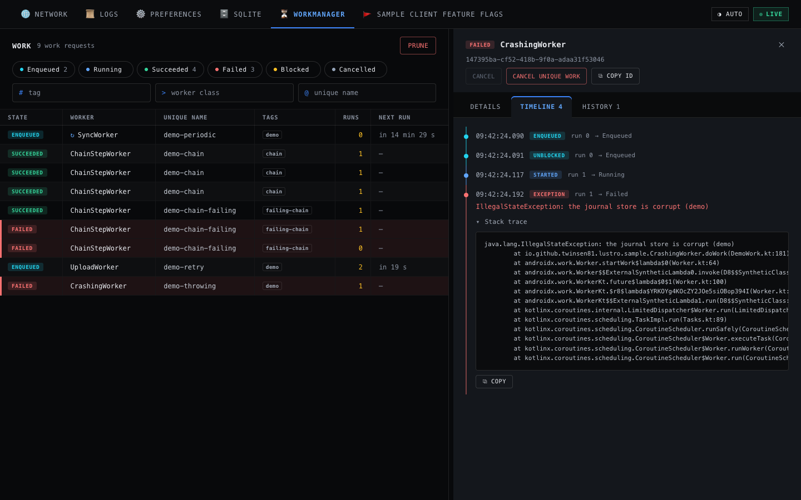

# Lustro { .md-visually-hidden }

{ .lustro-wordmark }
{ .lustro-wordmark }

Lustro is a debugging library for the debug builds of an Android app. It runs a
small web server in the app's process and shows the app's data as tabs in a
desktop browser. Every tab is also a JSON API, so AI agents, scripts, and the
`lustro` command-line tool can use the same data without a browser.

!!! warning "Early development"

    Lustro is pre-1.0. Only `0.1.0-SNAPSHOT` builds exist, from the Sonatype
    Central snapshots repository. The Kotlin API and the HTTP API can change
    from one snapshot to the next.



## What you get

| Tab | What it shows and does |
| --- | --- |
| **Network** | Captures OkHttp traffic, the messages of WebSockets, and, when you opt in, `HttpURLConnection` traffic. Mocks responses, throttles requests, sends requests through the app's own clients, and exports HAR files. |
| **Logs** | The app's own logcat, with filters for level, tag, text, and time. |
| **Preferences** | Reads and edits the app's SharedPreferences and Preferences DataStores. |
| **SQLite** | Reads the app's SQLite and Room databases, and runs SQL. Writes only to the databases that the app allows. |
| **WorkManager** | The app's work, the events of each run, and Cancel and Prune. |
| **Your own tabs** | A `DebugTab` subclass with JSON routes and, if you want, a view in the browser. |

The Network tab is in the main artifact. Each of the other built-in tabs is a
plugin with an artifact of its own.

A release build gets no server. Each artifact has a no-op half with the same
API and empty method bodies: you add the runtime with `debugImplementation`
and the no-op half with `releaseImplementation`, and the same code compiles
for both build types.

## Quick start

1. Add the snapshots repository to `settings.gradle.kts`:

    ```kotlin
    dependencyResolutionManagement {
        repositories {
            mavenCentral()
            maven("https://central.sonatype.com/repository/maven-snapshots/")
        }
    }
    ```

2. Add the runtime for debug builds and the no-op half for release builds, in
   the app module's `build.gradle.kts`:

    ```kotlin
    dependencies {
        debugImplementation("io.github.twinsen81:lustro:0.1.0-SNAPSHOT")
        releaseImplementation("io.github.twinsen81:lustro-noop:0.1.0-SNAPSHOT")
    }
    ```

3. Build Lustro once, in `Application.onCreate()`, add its interceptor to your
   OkHttp client, and start it on the main thread:

    ```kotlin
    val lustro = Lustro.builder(application)
        .addTab(NetworkDebugTab.create())
        .build()

    val httpClient = OkHttpClient.Builder()
        .addInterceptor(lustro.networkInterceptor())
        .build()

    lustro.start()
    ```

4. Run the debug build, keep the app in the foreground, and open the console.
   The `lustro` tool forwards the port and opens the browser with the token:

    ```bash
    lustro open
    ```

    Without the tool, forward the port with `adb forward tcp:8080 tcp:8080`,
    read the token with `adb logcat -d -s LustroToken`, and open
    `http://localhost:8080/#lustro_token=<token>`.

Lustro needs `minSdk` 24, `compileSdk` 35, Android Gradle Plugin 8.6, and
Kotlin 2.0. It does not raise the versions of your app's own dependencies.

## Next steps

- [User guide](https://github.com/Twinsen81/Lustro#readme): install options,
  capture setup, mock rules, the plugins, custom tabs, the security model, and
  troubleshooting.
- [Agents and automation](AGENTS.md): the `lustro` tool, token discovery, and
  the HTTP routes of each tab.
- [Custom tab styleguide](STYLEGUIDE.md): the design tokens and components of
  the console, for the view of your own tab.
- [Kotlin API reference](https://twinsen81.github.io/Lustro/api/): the public
  API of each published module, generated by Dokka.
