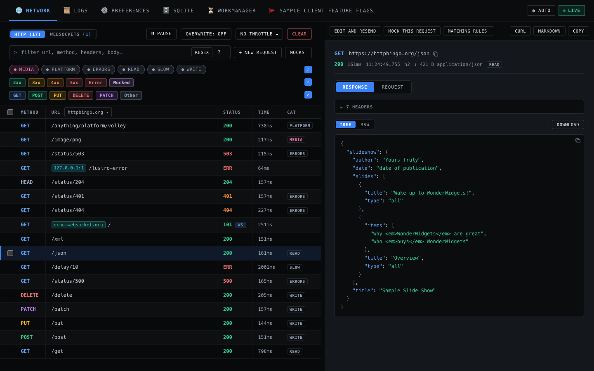

# Console controls

The Network tab has a list of the captured requests on the left, and the selected request on the
right. This page explains the controls above the list and above the request. Pause and Overwrite
change what Lustro records, and the throttle changes the app's traffic. The three settings are in
the app's memory: they apply to every console and every CLI client, and the app forgets them when
its process ends.

## The toolbar

| Control | What it does | CLI |
| --- | --- | --- |
| **HTTP** / **WebSockets** | Shows the HTTP requests, or the WebSocket connections and their messages. The number is how many each list has. See [WebSocket messages](websockets.md). | `lustro net list`, `lustro net ws list` |
| **⚠** | Shows when the app's capture filter left out a request: see [OkHttp capture setup](okhttp.md). | `lustro net state` |
| **⏸ Pause** | Stops the recording of new requests and WebSocket messages, and changes to **▶ Resume**. The interceptor still runs: mock rules and the throttle still apply. | `lustro net pause` |
| **Overwrite** | When on, a new request removes the earlier finished requests with the same method and URL path, so the list keeps one row for each endpoint. A request that is still in flight stays. The new row says how many rows it replaced. | `lustro net overwrite` |
| Throttle | Holds each OkHttp request for the time that you select, from 500 ms to 1 min, before it goes out or before a mock rule answers or fails it. | `lustro net throttle <ms>`, at most 600000 (10 min) |
| **Clear** | Removes the captured requests and WebSocket connections, and starts the capture filter's counts again. The mock rules and the settings stay. Shortcut: **C**. | `lustro net clear` |

**Use the throttle** to see a loading state, to test a timeout, or to find a race between two
requests. Select a delay, then do the action in the app. A held request is in the list while it
waits, and its detail shows how long the throttle held it (`throttledMs` in the API). Select
**No throttle** to stop. The
throttle holds only the requests of the OkHttp interceptor: a platform `HttpURLConnection`
request, and a request that [an adapter of your own](other-clients.md) reports, go out at once.

## Search

The search field finds a text in the URL, the method, the headers, and the bodies of each
request, ignoring case. The app runs the search on the device, 300 ms after you stop typing, and
the detail marks each match.

- **Regex** makes each word a Java regular expression that ignores case. All the words must
    match, each in any field, and a word that starts with `-` leaves out the requests that it
    matches. For example, `featured|popular -analytics` finds the requests with `featured` or
    `popular`, but without `analytics`. A regular expression that does not compile shows an error
    under the field. The console remembers this setting in your browser.
- **?** shows common regular expressions, with examples.
- **Ctrl+K** (**Cmd+K** on macOS) puts the cursor in the field, and **Escape** clears it.

From the CLI, `lustro net list --search <text>`, with `--regex` for regular expressions, gives the
same result: see
[Agents and automation](../AGENTS.md#search).

## Filters

Three rows of buttons under the search field hide rows of the list. The console remembers them
in your browser.

- **Categories.** One button for each label that the app's `NetworkClassifier` gave. `Sync`,
    `Auth`, `Media`, `Config`, `AI`, and `Wiretap` come first, in this order, and the other labels
    after them, in the order the console first saw them. A row shows when one of its labels is on. A row without a label
    always shows. See [Redaction and categories](redaction.md).
- **Statuses.** `2xx`, `3xx`, `4xx`, `5xx`, `Error` for a request that failed without a
    response, and `Mocked` for a request that a mock rule answered or failed.
- **Methods.** `GET`, `POST`, `PUT`, `DELETE`, `PATCH`, and `Other`.

## The list

Each row has the method, the path of the URL without its query, the status, the time, and the
categories. Click a row to show
the request on the right.

The checkbox of a row selects it. Shift-click selects the rows between two checkboxes, and the
checkbox in the header selects every row that the filters show. With a selection, a bar shows:

- **Copy Markdown** copies the selected requests and their responses as one Markdown document.
- **Export HAR** saves them as a HAR file. See [Export](export.md).
- **Clear selection** deselects every row.

## The selected request

The bar above the request has these buttons:

| Button | What it does |
| --- | --- |
| **Edit and resend** | Opens the request in the Send form, where you change it and send it again. It shows when the app gave Lustro a sender. See [Send Request](send-request.md). |
| **Mock this request** | Opens a mock rule for this method and URL, with the captured response, or with the failure of the rule that failed the request. See [Mock rules](mocks.md). |
| **Matching rules** | Lists the mock rules that match this request, enabled or not, in the order the app tries them. |
| **cURL** | Copies a `curl` command that sends the same request. |
| **Markdown** | Copies the request and the response as Markdown, for a bug report or a pull request. |
| **Copy** | Copies the status, the headers, and the bodies as plain text. |

Each body has the views that its type permits: **Tree** for JSON, **Pretty** for markup such as
XML or HTML, **Table** for a form, **Parts** for a multipart body, **Preview** for an image, and
**Raw** for the body as it is stored, with line numbers, or as a hex dump for a binary body. The console remembers the view that you
select for each content type.
