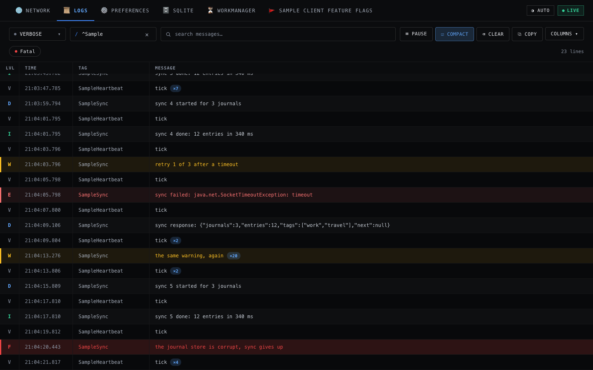

# Logs

The Logs plugin serves your app's own logcat over the API and in the console: a live tail,
filters, and a plain-text export.

## What the plugin does

- **The app's own logcat.** Your app gives the tab no data source: the tab runs
    `logcat --pid=<your app's pid>` itself, and needs no permission.
- **From the start of the process.** The tab reads logcat from `start()` to `stop()`, also while
    the app is in the background, and starts with the lines that your process wrote before
    `start()`. `stop()` ends the `logcat` process; the next `start()` goes on after the newest line.
- **Repeated lines fold.** A line that repeats the line before folds into it as a count, so a
    flood of one line costs almost nothing.

## Install

The plugin is a pair of artifacts, split by variant as `lustro` is:

```toml
lustro-logs      = { group = "io.github.twinsen81", name = "lustro-logs",      version.ref = "lustro" }
lustro-logs-noop = { group = "io.github.twinsen81", name = "lustro-logs-noop", version.ref = "lustro" }
```

```kotlin
dependencies {
    debugImplementation(libs.lustro.logs)
    releaseImplementation(libs.lustro.logs.noop)
}
```

In `lustro-logs-noop`, the tab reads no logs.

## Register the tab

```kotlin
val lustro = Lustro.builder(application)
    .addTab(NetworkDebugTab.create(senderClient = client))
    .addTab(LogsDebugTab.create())
    .build()
```

- **A bounded buffer.** The newest lines stay in memory, at most `bufferBytes` (default 4 MiB, by
    the size of their text on the heap, about 12,000 lines of 100 characters):
    `LogsDebugTab.create(bufferBytes = 8 * 1024 * 1024)`.

### Lines from the app's own logger

logcat keeps at most about 4 KB of a message, so a long one, such as a dump of a screen's state,
reaches the tab cut. When your app has a logger of its own, such as a Timber tree, the logger can
give each line to the tab in full with `append`, and name its tags in `appendedTags`, so that the
tab drops the cut copies that come from logcat:

```kotlin
val logs = LogsDebugTab.create(appendedTags = { it == "MyApp" })

// In the app's logger, before it writes the line to logcat:
logs.append(Log.DEBUG, "MyApp", message, throwable)
```

- **One list.** An appended line goes into the same buffer as the logcat lines, with the time,
    the process, and the thread of the `append` call, so the console, `GET entries`, and
    `GET text` show it as any other line. A throwable adds its stack trace after a line break, as
    `Log.e` does, and the line keeps its line breaks: `GET text` prints each of its lines with the
    prefix, as logcat does.
- **Each line once.** `appendedTags` takes a tag and says whether the logger appends its lines.
    The tab drops the logcat lines of those tags, so each line shows once, in full. Pass
    `setOf("A", "B")::contains` for a fixed set, or a test on the tag when the logger uses many
    tags. The lines of the platform and of libraries still come from logcat. For each tag, the rule
    holds from the first `append` of that tag on: older lines of the tag come from logcat, cut,
    because the logger could not append them yet. So no line is lost when the app gives the logger
    the tab some time after it creates the tab, as an app with dependency injection often does, and
    a tag that the logger never appends, for example in a build that does not install the logger,
    keeps all its logcat lines. Call `append` before the logger writes the line to logcat: when
    the logger writes to logcat first, the first line of a tag can show twice, as the cut copies
    from logcat and as the appended line. Timber calls its trees in the order in which the app
    planted them, so with Timber, call `append` in the tree that writes to logcat, before
    `super.log(...)`, or plant the tree that appends before `DebugTree`. When the order can't
    change, only the first line of each tag shows twice, and no line is lost.
- **A cap.** An appended text keeps at most 65,536 characters (`MAX_APPENDED_CHARS`), and in a
    small buffer at most an eighth of `bufferBytes`, so that one line can't empty the buffer. A
    longer text ends with `… cut (N more characters)`.
- **The order.** An appended line goes into the list when `append` is called. A logcat line goes
    in when the reader reads it: usually some milliseconds after it was written, but much later at
    the app's start, when the reader first reads the lines of the process from its start, and
    after `stop()` and `start()`, when it reads the lines it missed. So the list can show an
    appended line before logcat lines that are older, and the time column is not always in order.
- `append` is safe to call from any thread, also before `start()` and after `stop()`. In
    `lustro-logs-noop` it does nothing.

## Safety options

The Logs tab has no safety options. Log lines are served as the app wrote them, not redacted,
tokens that an `HttpLoggingInterceptor` logs among them, and every client with the token reads
them. Its `POST` routes change only the tab's own buffer. See
[SECURITY.md](https://github.com/Twinsen81/Lustro/blob/main/SECURITY.md#threat-model).

## Console view

- **A live tail.** The **Logs** tab follows the newest lines, with a lowest level, a tag regex,
    and a message search, which the app applies to its whole buffer. It can pause, fold repeated
    lines, clear the buffer, copy the lines it shows as text, and show or hide the Time, Level,
    Tag, and PID / TID columns.
- **Levels.** The **Fatal** chip shows the lines at level F (`Log.ASSERT`); a Java crash and
    `Log.wtf()` are at level E.
- **JSON.** A line with JSON in it opens indented from the toolbar that shows on a row after a
    second.
- **A time range.** A link such as `/tab/logs#from=<ms>&to=<ms>`, which the WorkManager tab has
    for each run of a worker, opens the tab with only the lines of that time range, and a chip
    that clears it.



## HTTP routes

`GET /api/v1/logs/entries` polls the log in the stream envelope. `GET /api/v1/logs/text` exports
it as logcat's threadtime text. Both take the same filters, and a line must pass all of them:

- **`level`**: the lowest level, one of `V D I W E F`. `W` gives W, E, and F.
- **`tag`**: a Java regular expression that the tag must contain, case-sensitive.
- **`q`**: a text that the message must contain, ignoring case.
- **`mq`**: a Java regular expression that the message must contain, case-sensitive. Use it when
    `q` is not enough, such as `mq=(?i)timeout|refused` for either word in any case, or
    `mq=^HTTP 5\d\d` for a message that starts with a 5xx status.
- **`from` and `to`**: a time range in epoch milliseconds, both ends included, such as the run of
    a worker.

`tag` and `mq` are found anywhere in the text: anchor them with `^` and `$`, and add `(?i)` to
ignore case. Each is at most 200 characters, and one that does not compile gets a `400` with its
`field`. Keep them simple: a regular expression that backtracks a lot, such as `(a+)+$`, can hold
the request for a long time. `POST clear`, `pause`, and `compact` control the log. See [Agents and automation](../AGENTS.md#logs-tab-operations) and
[`logs.openapi.json`](https://github.com/Twinsen81/Lustro/blob/main/lustro-logs/openapi/logs.openapi.json).

## CLI examples

The CLI has no `logs` commands: `lustro api` reaches the routes.

```bash
# The app's warnings and errors, as logcat's threadtime text.
lustro api GET logs/text --param level=W

# The lines of one tag, as JSON items.
lustro api GET logs/entries --param tag=OkHttp --param limit=50

# The lines whose message contains a text, ignoring case.
lustro api GET logs/text --param q=timeout

# The lines whose message matches a regular expression: here, either word, in any case.
lustro api GET logs/text --param 'mq=(?i)timeout|refused'

# Empty the buffer before a test step.
lustro api POST logs/clear
```

## Limits

- **Only what reached logd.** A line that never reached logd is not in the tab, as it is not in
    `adb logcat`: one physical Android 16 device sets `log.tag` to `E` for about a second while an
    app starts, and drops the lines below Error of every process in that time.
- **Only the app's own lines.** The tab's `logcat` runs as your app, so it also leaves out the
    lines that the process wrote as root before it became your app, such as
    `libprocessgroup: Created cgroup ...`, which `adb logcat --pid` shows.
- **No crash that ends the process.** A crash that ends the app's process ends the server too, so
    the tab never shows it: read it with `adb logcat`.
- **Logcat's own limits.** A message longer than logcat's limit of about 4 KB is cut, as in
    `adb logcat`, unless the app's logger appends it (see
    [Lines from the app's own logger](#lines-from-the-apps-own-logger)). So is a tag longer than about 88 bytes: logcat prints the first part of it, and
    the message after.
