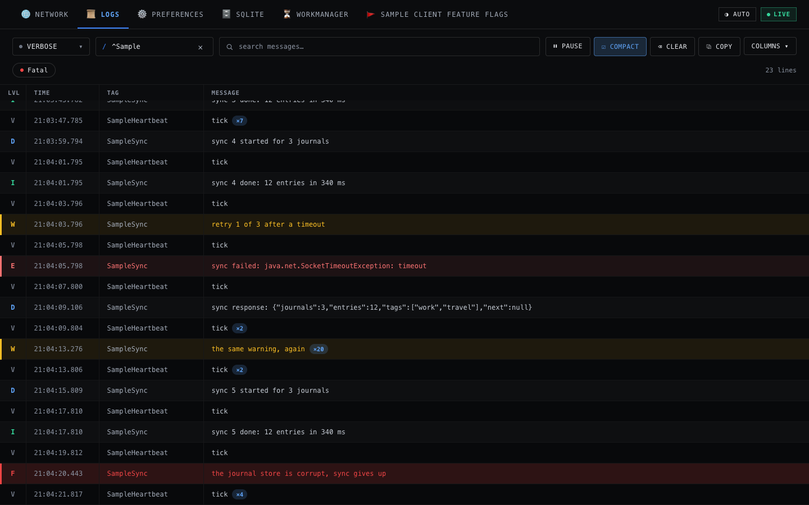

# Logs

The Logs plugin serves your app's own logcat over the API and in the console: a live tail,
filters, and a plain-text export.

## What the plugin does

- **The app's own logcat.** Your app gives the tab no data source: the tab runs
    `logcat --pid=<your app's pid>` itself, and needs no permission.
- **From the start of the process.** The tab reads logcat from `start()` to `stop()`, also while
    the app is in the background, and starts with the lines that your process wrote before
    `start()`. `stop()` ends the `logcat` process; the next `start()` goes on after the newest line.
- **Repeated lines fold.** A line that repeats the line before folds into it as a count, so a
    flood of one line costs almost nothing.

## Install

The plugin is a pair of artifacts, split by variant as `lustro` is:

```toml
lustro-logs      = { group = "io.github.twinsen81", name = "lustro-logs",      version.ref = "lustro" }
lustro-logs-noop = { group = "io.github.twinsen81", name = "lustro-logs-noop", version.ref = "lustro" }
```

```kotlin
dependencies {
    debugImplementation(libs.lustro.logs)
    releaseImplementation(libs.lustro.logs.noop)
}
```

In `lustro-logs-noop`, the tab reads no logs.

## Register the tab

```kotlin
val lustro = Lustro.builder(application)
    .addTab(NetworkDebugTab.create(senderClient = client))
    .addTab(LogsDebugTab.create())
    .build()
```

- **A bounded buffer.** The newest lines stay in memory, at most `bufferBytes` (default 4 MiB, by
    the size of their text on the heap, about 12,000 lines of 100 characters):
    `LogsDebugTab.create(bufferBytes = 8 * 1024 * 1024)`.

## Safety options

The Logs tab has no safety options. Log lines are served as the app wrote them, not redacted,
tokens that an `HttpLoggingInterceptor` logs among them, and every client with the token reads
them. Its `POST` routes change only the tab's own buffer. See
[SECURITY.md](https://github.com/Twinsen81/Lustro/blob/main/SECURITY.md#threat-model).

## Console view

- **A live tail.** The **Logs** tab follows the newest lines, with a lowest level, a tag regex,
    and a message search, which the app applies to its whole buffer. It can pause, fold repeated
    lines, clear the buffer, copy the lines it shows as text, and show or hide the Time, Level,
    Tag, and PID / TID columns.
- **Levels.** The **Fatal** chip shows the lines at level F (`Log.ASSERT`); a Java crash and
    `Log.wtf()` are at level E.
- **JSON.** A line with JSON in it opens indented from the toolbar that shows on a row after a
    second.
- **A time range.** A link such as `/tab/logs#from=<ms>&to=<ms>`, which the WorkManager tab has
    for each run of a worker, opens the tab with only the lines of that time range, and a chip
    that clears it.



## HTTP routes

`GET /api/v1/logs/entries` polls the log in the stream envelope, with `level`, `tag`, `q`, and
`mq` filters, and `from` and `to`, a time range in epoch milliseconds, such as the run of a
worker. `GET /api/v1/logs/text` exports it as logcat's threadtime text. `POST clear`, `pause`,
and `compact` control it. See [Agents and automation](../AGENTS.md#logs-tab-operations) and
[`logs.openapi.json`](https://github.com/Twinsen81/Lustro/blob/main/lustro-logs/src/main/assets/lustro/logs.openapi.json).

## CLI examples

The CLI has no `logs` commands: `lustro api` reaches the routes.

```bash
# The app's warnings and errors, as logcat's threadtime text.
lustro api GET logs/text --param level=W

# The lines of one tag, as JSON items.
lustro api GET logs/entries --param tag=OkHttp --param limit=50

# The lines whose message contains a text, ignoring case.
lustro api GET logs/text --param q=timeout

# Empty the buffer before a test step.
lustro api POST logs/clear
```

## Limits

- **Only what reached logd.** A line that never reached logd is not in the tab, as it is not in
    `adb logcat`: one physical Android 16 device sets `log.tag` to `E` for about a second while an
    app starts, and drops the lines below Error of every process in that time.
- **Only the app's own lines.** The tab's `logcat` runs as your app, so it also leaves out the
    lines that the process wrote as root before it became your app, such as
    `libprocessgroup: Created cgroup ...`, which `adb logcat --pid` shows.
- **No crash that ends the process.** A crash that ends the app's process ends the server too, so
    the tab never shows it: read it with `adb logcat`.
- **Logcat's own limits.** A message longer than logcat's limit of about 4 KB is cut, as in
    `adb logcat`. So is a tag longer than about 88 bytes: logcat prints the first part of it, and
    the message after.
