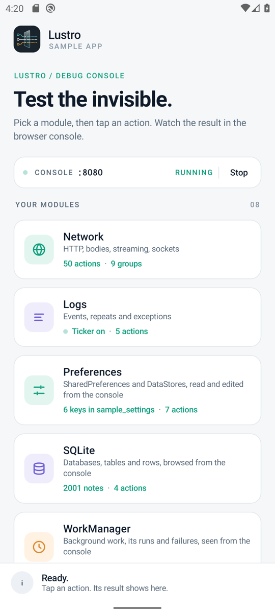

# Screen

The Screen plugin gives an agent or a script your app's UI as a tree, over the API: each window
of your app's process, and in each, the classic Views and the Compose semantics nodes, with their
test tags, text, bounds, states, and actions. The tab reads them in your app's process, in
milliseconds, where `uiautomator dump` takes a second or more for each read.

## What the plugin does

- **Every window of the app.** `GET /api/v1/screen/tree` returns the activity's window and each
    dialog, popup, and bottom sheet over it, in the order your app added them. From API 29 the tab
    lists them with `WindowInspector`; before that it reads `WindowManagerGlobal` by reflection, as
    Espresso does, and when that fails, the windows of the started activities, without their
    dialogs and popups. Each window says whether it has the window focus. When none has it, a
    window of another app is on top, such as a permission dialog or the chooser, and the tree does
    not have that window.
- **Compose and Views.** The tab reads the View tree of every window, and the semantics tree of
    each Compose host in it: the merged tree by default, as accessibility services see it, and the
    unmerged one with `merged=false`. Every test tag is in it, whether your app sets
    `testTagsAsResourceId` or not.
- **What a node has.** Its id, which stays the same from read to read; its test tag, text,
    content description, editable text, and role; its bounds in the window and on the screen; the
    part of it that is visible on the screen, or `null` when no part of it is, as for a row
    scrolled out of view; whether it is enabled, focused, selected, and on or off; the actions that
    drive it, such as `OnClick`, `SetText`, and `ScrollBy`; and its scroll position and range. A
    password field has one dot for each character, as the screen shows it.
- **On the main thread.** `settle=500` reads the tree on each frame until two reads in a row are
    the same and the window focus is at rest, for up to 500 ms, for a screen that still changes:
    the window manager moves the focus some frames after a dialog opens or closes, 200 ms and more
    on a physical device. A main thread that does not run the read within five seconds gets the
    client a `504` with the code `main_thread_blocked`, so a script does not wait for an app that
    does not respond.

## Install

The plugin is a pair of artifacts, split by variant as `lustro` is:

```toml
lustro-screen      = { group = "io.github.twinsen81", name = "lustro-screen",      version.ref = "lustro" }
lustro-screen-noop = { group = "io.github.twinsen81", name = "lustro-screen-noop", version.ref = "lustro" }
```

```kotlin
dependencies {
    debugImplementation(libs.lustro.screen)
    releaseImplementation(libs.lustro.screen.noop)
}
```

Compose is optional: the tab compiles against Compose UI 1.6.0 as `compileOnly`, checks at
runtime that your app has Compose, and in an app without it reads the Views only.

In `lustro-screen-noop`, the tab reads no window and never calls the provider.

## Register the tab

```kotlin
val lustro = Lustro.builder(application)
    .addTab(NetworkDebugTab.create(senderClient = client))
    // The lambda is optional: what only your app knows about the screen, as JSON.
    .addTab(ScreenDebugTab.create(application) { """{"route":"${navigator.currentRoute}"}""" })
    .build()
```

- **Your app's context.** A `ScreenContextProvider` returns what only your app knows, such as
    its navigation back stack, as JSON. The tab calls it on the main thread after each read, and
    the tree carries it as `context`.

## Safety options

The Screen tab has no safety options: it only reads, and it has no route that changes the app.
Every client with the token reads the screen, with what it shows, but the text of password
fields. See [SECURITY.md](https://github.com/Twinsen81/Lustro/blob/main/SECURITY.md#the-screen).

## Console view

The Screen tab has no console view yet: it is not in the tab bar, and `_meta` lists it. See
[Sample output](#sample-output) for what it gives for a screen of the sample app.

## HTTP routes

`GET /api/v1/screen/tree` returns the windows and their nodes. `merged=false` gives the unmerged
semantics tree. `settle=MS` goes from 0 to 10000: `0`, the default, reads once, and a larger
value reads until the screen is at rest, for up to MS. See [Agents and automation](../AGENTS.md#screen-tab-operations) and
[`screen.openapi.json`](https://github.com/Twinsen81/Lustro/blob/main/lustro-screen/src/main/assets/lustro/screen.openapi.json).

## CLI examples

`lustro screen tree` prints each window and the nodes on the screen that have a text, a tag, a
role, an action, or a state, one line each, with the part of each node that is on the screen, in
uiautomator's bounds format.

```bash
# The windows, and the nodes on the screen.
lustro screen tree

# Read after a tap, when the screen is at rest.
lustro screen tree --settle 500

# Every node of the unmerged tree.
lustro screen tree --unmerged --all

# The whole response, as JSON.
lustro screen tree --json
```

A script that reads the tree in a loop sends the GET itself, with a token and a forward that it
keeps: see [Agents and automation](../AGENTS.md#screen-tab-operations).

### Sample output

The sample app's main screen, on an emulator with API 29, at 1080 × 2400 pixels:

{ width="300" }

`lustro screen tree` prints this for it:

```text
window 0  activity  io.github.twinsen81.lustro.sample/io.github.twinsen81.lustro.sample.MainActivity  focus  [0,0][1080,2400]
  c5.6  node  scroll-v 0/927  scroll  [0,63][1080,2205]
    c5.12  node  "Lustro"  [190,108][319,164]
    c5.13  node  "SAMPLE APP"  [190,164][403,198]
    c5.16  node  "LUSTRO / DEBUG CONSOLE"  [53,279][490,313]
    c5.18  node  "Test the invisible."  [53,339][679,438]
    c5.20  node  "Pick a module, then tap an action. Watch the result in the …"  [53,459][1027,555]
    c5.22  Button  "CONSOLE / :8080 / RUNNING"  #Console strip  click  [53,613][1027,737]
      c5.33  Button  "Stop"  #Stop the Lustro server  click  [872,634][1006,716]
    c5.41  node  "YOUR MODULES"  [58,784][981,818]
    c5.42  node  "08"  [981,784][1022,818]
    c5.43  Button  "Network / HTTP, bodies, streaming, sockets / 50 actions / ·…"  #Network  click  [53,860][1027,1093]
    c5.57  Button  "Logs / Events, repeats and exceptions / Ticker on / · / 5 a…"  #Logs  click  [53,1125][1027,1358]
    c5.72  Button  "Preferences / SharedPreferences and DataStores, read and ed…"  #Preferences  click  [53,1390][1027,1665]
    c5.86  Button  "SQLite / Databases, tables and rows, browsed from the conso…"  #SQLite  click  [53,1697][1027,1972]
    c5.100  Button  "WorkManager / Background work, its runs and failures, seen …"  #WorkManager  clipped  click  [53,2004][1027,2205]
  c5.155  node  desc="Ready"  #result-outcome  [42,2237][131,2326]
  c5.163  node  "Ready."  #result  [163,2242][269,2285]
  c5.164  node  "Tap an action. Its result shows here."  [163,2285][660,2322]
context: {"screen":"home","stack":["home"],"historyOpen":false}
```

How to read it:

- **The window line.** The index of the window, its kind, its title, `focus` when it has the
    window focus, and its bounds. A dialog or a bottom sheet over the activity is a second window
    line, with its own nodes.
- **A node line.** The node's id, its role, or `node` when it has none, its texts, its test tag
    after `#`, its states and actions, and the part of it that is on the screen. An id that starts
    with `v` is a View. An id that starts with `c` is a Compose semantics node: `c5.33` is a node
    of the Compose host View `v5`. The indent shows the parent of each node.
- **Texts.** In the merged tree, a node also has the texts of its children, and the CLI joins
    them with ` / `, so `"CONSOLE / :8080 / RUNNING"` is three texts. `"LUSTRO / DEBUG CONSOLE"` is one text that has
    a slash: `--json` and `--unmerged` show the difference. The CLI cuts a text at 60 characters.
- **States and actions.** `click` is `OnClick`, and `scroll` is `ScrollBy`. `scroll-v 0/927` is
    the vertical scroll position and its maximum, in pixels. `clipped` marks a node that is only
    partly on the screen: the list `c5.6` ends at y=2205, above the result bar, so the line of the
    WorkManager card ends there too. Its `bounds` in `--json` end at y=2279.
- **What is not there.** The Screen, Feature flags, and Console cards are further down the list,
    and the lines leave them out. `--all` prints them with `(not on screen)`. The status bar and
    the navigation bar belong to the system, not to the app.
- **`context`.** What the sample's `ScreenContextProvider` returned: its own navigation state.

`--json` gives each node in full. The **Stop** button, from the same read:

```json
{
  "id": "c5.33",
  "parent": "c5.22",
  "kind": "compose",
  "testTag": "Stop the Lustro server",
  "text": ["Stop"],
  "role": "Button",
  "bounds": { "left": 872, "top": 634, "right": 1006, "bottom": 716 },
  "screenBounds": { "left": 872, "top": 634, "right": 1006, "bottom": 716 },
  "visibleBounds": { "left": 872, "top": 634, "right": 1006, "bottom": 716 },
  "clickable": true,
  "actions": ["OnClick"]
}
```

To press it, tap the middle of its `visibleBounds`: `adb shell input tap 939 675`. The whole
response for this screen is about 9 KB. It also has `merged`, `density`, `compose`, and
`windowSource`, which says how the tab found the windows: `inspector` from API 29, and
`reflection` or `activities` before.

## Limits

- **Only the app's windows.** Permission dialogs, the chooser and the share sheet, the keyboard,
    notifications, the text toasts that the system shows from API 30, and the page in a WebView
    are not in the tree: read them with `uiautomator`.
