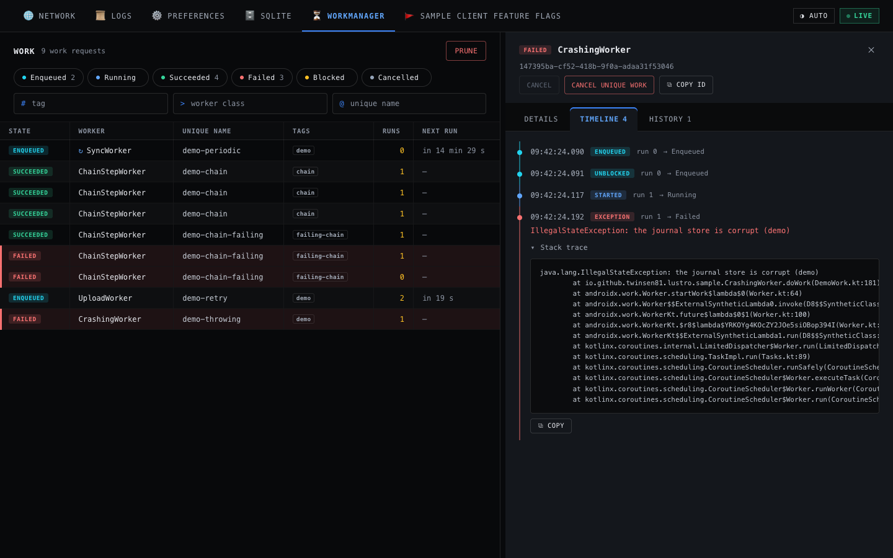

# WorkManager

The WorkManager plugin shows your app's WorkManager work and the events of each run over the API
and in the console, cancels work, and prunes finished work.

## What the tab shows

- **Every work request.** Its state, tags, attempts, output, progress, constraints, and schedule.
- **The events of each run.** The result and its output, the stop reason, and what a worker
    threw. With work-analytics, the tab also shows the times and attempts of the runs of earlier
    processes.
- **Events live on the heap.** The tab records the events from `start()` to `stop()`, also while
    the app is in the background, and keeps at most `bufferBytes` of them (default 1 MiB, by the
    size of their JSON on the heap). Its listeners forward to yours either way.
- **Unique names and chains.** `WorkInfo` has no unique name, so the tab reads the name of each
    work from WorkManager's own database, through WorkManager's connection, also a name that the app
    makes for each work, such as the URL of a download. It reads the work that each work waits for,
    the work before it in a chain of `beginWith()` and `then()`, in the same way. The table of the
    names and its call have been the same since WorkManager 2.0, but the tables and calls are
    WorkManager's internals: when a later WorkManager changes them, the tab logs it once, labels the
    work of the names in `uniqueNames` only, and shows no chains. `GET items?name=` finds the work
    of any name.

## Install

The plugin needs WorkManager 2.12.0 or newer, and is a pair of artifacts, split by variant as
`lustro` is:

```toml
lustro-work      = { group = "io.github.twinsen81", name = "lustro-work",      version.ref = "lustro" }
lustro-work-noop = { group = "io.github.twinsen81", name = "lustro-work-noop", version.ref = "lustro" }
```

```kotlin
dependencies {
    debugImplementation(libs.lustro.work)
    releaseImplementation(libs.lustro.work.noop)
}
```

In `lustro-work-noop`, `configure()` returns the builder as it is, and the tab reads nothing.

## Register the tab

The events come from the listeners that WorkManager 2.12 added to its `Configuration`, so your
app's configuration goes through the tab. Initialize WorkManager on demand: implement
`Configuration.Provider` (or call `WorkManager.initialize`), remove `WorkManagerInitializer` from
the manifest, and pass the builder through a function of your variant-split bootstrap, so that
`src/main` names no Lustro type:

```kotlin
// src/main
class App : Application(), Configuration.Provider {
    override val workManagerConfiguration: Configuration
        get() = LustroBootstrap.workManagerConfiguration(this, Configuration.Builder().setWorkerFactory(workerFactory)).build()
}

// src/debug and src/release, LustroBootstrap: the same code against lustro-work and lustro-work-noop
private var work: WorkDebugTab? = null

// WorkManager can ask for its configuration on another thread, before or after start(): one tab for both.
@Synchronized
private fun work(app: Application): WorkDebugTab =
    work ?: WorkDebugTab.create(app, uniqueNames = listOf("sync", "upload")).also { work = it }

fun workManagerConfiguration(app: Application, builder: Configuration.Builder): Configuration.Builder =
    work(app).configure(builder)

fun start(app: Application) {
    Lustro.builder(app).addTab(work(app)).build().start()
}
```

```xml
<provider
    android:name="androidx.startup.InitializationProvider"
    android:authorities="${applicationId}.androidx-startup"
    tools:node="merge">
    <meta-data
        android:name="androidx.work.WorkManagerInitializer"
        android:value="androidx.startup"
        tools:node="remove" />
</provider>
```

An app whose debug build already has an `Application` of its own in `src/debug`, a subclass of
the one in `src/main`, can implement `Configuration.Provider` there instead, with the tab in a
field of it, and remove `WorkManagerInitializer` in `src/debug/AndroidManifest.xml` only. The
release build then keeps WorkManager's default initializer, and `src/main` does not change.

From Java, the provider is a method, and every factory has overloads without the trailing
parameters:

```java
// src/main
public class App extends Application implements Configuration.Provider {
    @NonNull
    @Override
    public Configuration getWorkManagerConfiguration() {
        return LustroBootstrap.workManagerConfiguration(this, new Configuration.Builder()).build();
    }
}

// src/debug and src/release, LustroBootstrap
private static WorkDebugTab work;

static synchronized WorkDebugTab work(Application app) {
    if (work == null) work = WorkDebugTab.create(app, Arrays.asList("sync", "upload"));
    return work;
}
```

- **Your listeners keep working.** `configure()` sets the tab's execution and schedule listeners
    on the builder and returns it. Each one records the event and then calls the listener that you
    set before, with the same arguments, so call `configure()` last. What your listener throws
    reaches WorkManager as without the tab. The listener API is `@ExperimentalEventsApi`; the
    opt-in stays inside `lustro-work`.
- **The tab never initializes WorkManager.** Until your app calls `WorkManager.getInstance`, the
    routes that read work answer `503` with code `work_not_initialized`.
- **When there are no events.** The `state` of `items`, `items/{id}`, and `events` has `listeners`: `installed`, `missing` when
    your configuration did not go through `configure()` or WorkManager runs with another one (the
    default initializer is still in the manifest), or `unsupported` when your WorkManager has
    listener methods that this version of Lustro does not forward. `state.reason` says what to
    change. Without WorkManager 2.12.0 or newer, every route answers `503` with code
    `work_unsupported`, and `configure()` returns the builder as it is. The message names the
    version that the app has when the APK has WorkManager's version file,
    `META-INF/androidx.work_work-runtime.version`; a packaging exclude of `META-INF/*.version`
    leaves it out.
- **History on disk with work-analytics.** If your app uses `androidx.work:work-analytics`, set its
    `WorkMetricsInfoRepository` as both of your listeners, and pass it to the tab with
    `WorkDebugTab.createWithMetrics(app, metrics = repository, uniqueNames = ...)`, which has a name of its own
    so that an app without work-analytics, in Java too, never needs its types. `GET metrics` then reads
    the enqueue, start, and finish times, durations, attempts, retries, and stop reasons of each
    run, kept 7 days by default. Lustro never depends on work-analytics: its POM pins
    `work-runtime` to its own exact version.
- **work-analytics 2.12.0 can end the app's process.** When an event comes for work that has no
    open period, the repository inserts period 0 again, and when it closed period 0 before, it
    throws `SQLiteConstraintException` on WorkManager's thread. That happens when work is cancelled
    while it runs, also from the console's `POST cancel` (`onStopped` comes after `onCancelled`), at
    the next run of a periodic worker that threw (`onException` opens no next period), and when the
    process dies after the repository closed a run but before WorkManager saved the result, so that
    WorkManager runs it again. In the last two cases, every later run of that work fails the same
    way, so the app ends at each start until its data is cleared. The sample's `MetricsListeners`
    wraps the repository and catches that exception in every listener method.

## Safety options

The WorkManager tab has no safety options. Only `POST cancel` and `POST prune` change anything,
and every client with the token can cancel and prune your work. Output data and exceptions can
hold user data. See [SECURITY.md](https://github.com/Twinsen81/Lustro/blob/main/SECURITY.md#workmanager-work).

## Console view

The **WorkManager** tab lists the work with its state, worker, unique name, tags, attempts, and
next run.

- **The list.** A tag that every work in the list has, such as one that the app puts on all its
    work, shows after the tags of each work. A tag that is the work's unique name, which apps add
    because `WorkInfo` has none, shows only in Details. Blocked work shows `after others`:
    WorkManager runs it when the work before it in its chain has succeeded, which Details lists
    under **Waits for**, each a link that opens it. Enqueued work whose next run has passed shows
    `waiting`, and says for which constraints: WorkManager runs it when they are met, such as at a
    change of a content URI that it watches. For periodic work, the attempts are those of the
    current period: WorkManager sets the count back to 0 when a period ends, so it is 0 after a run
    that finished.
- **Filters.** The state chips show the count of each state and filter the list by it, and the
    tag, worker class, and unique name fields go to the route.
- **One work.** A click on a work opens it. **Details** has its id, class, tags, constraints, with
    the transports and capabilities of a `NetworkRequest` that the app set with
    `setRequiredNetworkRequest`, periodicity, initial delay, next run, attempts, generation, last
    stop reason, output, and progress, with a bar when the progress is one number from 0 to 100,
    which the list also shows next to `running`. **Timeline** has the events of its runs, with the
    result, the output, the stop reason, and a worker's exception with its stack trace, and, when
    the app registers the Logs tab, a link at the end of each run to the app's log lines from a
    second before the run to a second after it, which say why a worker that returned
    `Result.failure()` without output failed. **History**, with work-analytics, has its periods.
- **Actions.** **Cancel**, **Cancel unique work**, and **Prune** ask first, and with work-analytics
    the cancel dialogs say that a cancel of running work can end the app's process (see above).
    **Cancel** is off for finished work, and **Cancel unique work** when all work of the name in
    the list has finished, each with the reason as its title; with a tag or class filter, the list
    can't tell, and the route answers `cancelled: 0`.
- **Banners.** When the listeners are not installed, a banner says why, and how to fix it. While
    the routes answer `503`, the actions are off; with `work_unsupported`, the banner shows the
    app's WorkManager version when it is known, and the list asks again every 30 s instead of
    every second.



## HTTP routes

- `GET /api/v1/work/items` polls the work in the cursor envelope, with `state`, `tag`, `class`,
    and `name` filters.
- `GET items/{id}` gives one work request with its events and history.
- `GET events` polls the events in the stream envelope, with `id`, `class`, and `type` filters.
- `GET metrics` reads work-analytics.
- `POST cancel` cancels work by `id`, `name`, or `tag`.
- `POST prune` deletes finished work, as `WorkManager.pruneWork()` does.

See [Agents and automation](../AGENTS.md#workmanager-tab-operations) and
[`work.openapi.json`](https://github.com/Twinsen81/Lustro/blob/main/lustro-work/src/main/assets/lustro/work.openapi.json).

## CLI examples

The CLI has no `work` commands: `lustro api` reaches the routes.

```bash
# The results and failures of the app's workers.
lustro api GET work/events --param type=finished,exception

# The work that failed or was cancelled.
lustro api GET work/items --param state=FAILED,CANCELLED

# One work request, with its events and history.
lustro api GET work/items/<id>

# Cancel the work of a unique name.
lustro api POST work/cancel --body '{"name":"sync"}'
```

## Limits

- **Events end with the process.** When the system starts your app in the background to run a
    worker and stops it before you open the app, the events of that run are lost. The work's state,
    attempts, last stop reason, and output stay in WorkManager's snapshot, and a worker's exception
    is in logcat (`WM-WorkerWrapper`).
- **Not shown:** a work's input data, which WorkManager's public API does not have, and the place
    in your code that enqueued the work: the listeners run on WorkManager's own threads. The SQLite
    tab can read WorkManager's database as a file:
    `SqliteDb.file("workmanager", File(app.noBackupFilesDir, "androidx.work.workdb"))`, but its
    schema changes between releases.
